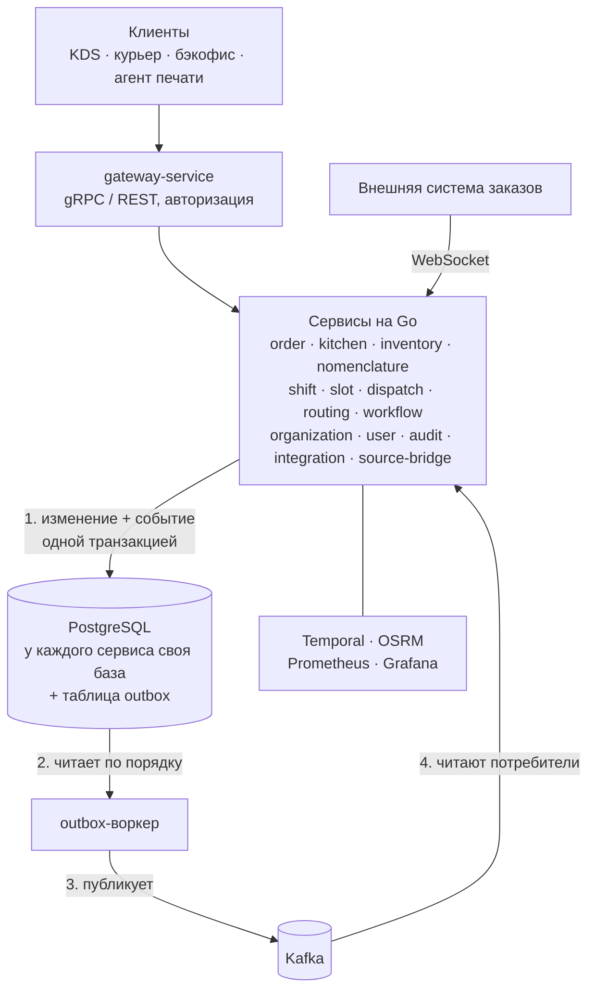
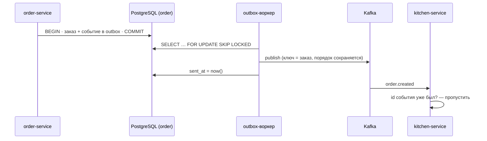
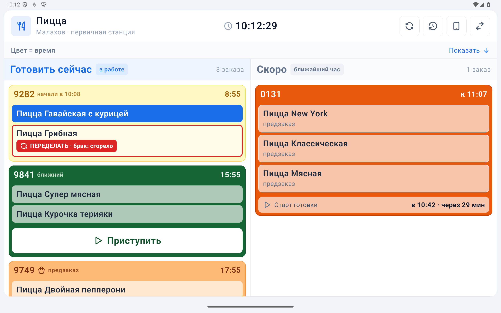
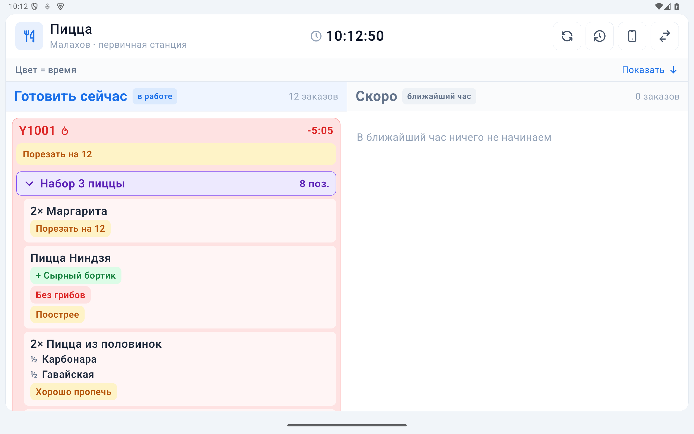
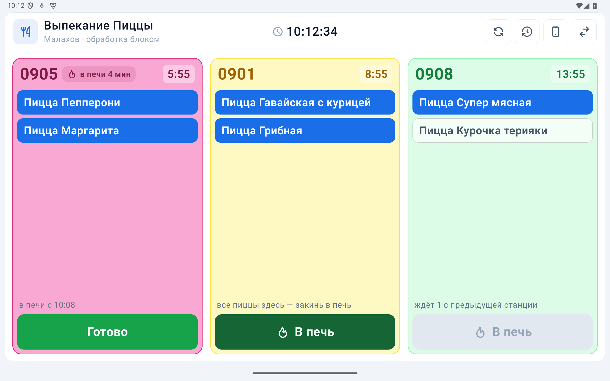

# Flowix — ERP для сети пиццерий

Витрина проекта **Flowix**. Это система управления сетью пиццерий, которую я спроектировал и разрабатываю с нуля. С 2026 года она работает в продакшене в сети Ninja Pizza (Красноярск): **8 филиалов, около 900 заказов в день**. Ею каждый день пользуются повара, упаковщики, курьеры и управляющие.

Код самой системы закрытый: он принадлежит бизнесу и содержит его данные. Здесь лежат описание архитектуры, экраны на тестовых данных и три небольших примера на Go. Примеры написаны заново для этой витрины, но решают те же задачи, что и боевой код.

> *English summary:* production ERP for a pizza delivery chain (8 branches, ~900 orders/day) — 15 Go microservices, gRPC/Protobuf, Kafka with transactional outbox, PostgreSQL, Temporal, Android KDS on Kotlin/Compose. This repo holds the architecture overview and three self-contained Go examples with tests.

## Что делает система

- **Кухня (KDS).** Android-планшеты на станциях: сборка пиццы, закуски, печь, упаковка. Заказ идёт по маршруту станций. Каждая станция отмечает своё: «Приступить», «В печь», «Готово», «Упаковал». Цвет карточки показывает, сколько осталось до срока.
- **Маркировка.** Наклейки на каждую позицию по ТР ТС 022: состав с учётом добавок, КБЖУ, срок годности, QR-код. Печатаются сами на термопринтерах филиала.
- **Курьеры.** Приложение на Android и веб-версия для iPhone. Запись на смены, места по дням недели, живые заказы. Перед выдачей курьер проверяет пакет по QR-кодам наклеек, чтобы не было недовозов.
- **Бэкофис.** Номенклатура и техкарты, склад, сводка заказов с разбором, где заказ задержался: кухня, ожидание курьера, дорога.
- **Интеграции.** Приём заказов из внешней системы, бот в мессенджере MAX, агенты печати в сети филиалов.

## Архитектура

Как событие доходит от сервиса до сервиса:

- **15 сервисов на Go**, у каждого своя база PostgreSQL и миграции. SQL типобезопасный, через [go-jet](https://github.com/go-jet/jet).
- **Контракты:** gRPC и Protobuf в отдельном репозитории с семантическими версиями. Go-сервисы и Android-клиент подключают его по тегу.
- **События — через transactional outbox.** Сервис пишет изменение и событие в свою базу одной транзакцией, отдельный воркер публикует события из outbox в Kafka по порядку. Событие откатившейся транзакции не уходит, а уже записанное не теряется. Потребители идемпотентны: повторная доставка не ломает данные.
- **Долгие процессы** (заказ ко времени, рейсы курьеров) — на Temporal.
- **Инфраструктура:** Docker Compose на VPS, CI/CD через GitHub Actions, метрики и алерты в Telegram, ежедневные бэкапы. Интеграционные тесты идут на одноразовых базах.

## Экраны (тестовые данные)

| Сборка: «Приступить», брак → «Переделать» | Доска пиццы в пик: наборы, половинки, добавки |
|---|---|
|  |  |

| Выпекание: «В печь» |
|---|
|  |

## Примеры кода

Каждый пакет самостоятельный, со своими тестами (`go test -race ./...`).

### [`boarddelta`](boarddelta) — доска кухни снимком и изменениями

На станции в пик 30–60 заказов, и они меняются несколько раз в секунду. Если каждый раз слать доску целиком, планшеты перерисовывают все карточки и подтормаживают. Поэтому сервер помнит, что уже отправил, и шлёт только изменившиеся заказы и номера ушедших. Каждое сообщение пронумеровано. Клиент, который пропустил номер, не пытается угадать недостающее, а запрашивает новый снимок.

### [`printonce`](printonce) — наклейки ровно один раз

Наклейки одного заказа просят напечатать с разных мест: печь, раздача во внешней системе, кнопка упаковщика, агент печати. Эти запросы приходят наперегонки, а планшет может потерять Wi-Fi посреди печати. Поэтому заказ сначала занимается, а после печати печать подтверждается. Неподтверждённая заявка истекает, чтобы планшет, отключившийся посреди печати, не заблокировал заказ навсегда. Есть тест на 50 одновременных запросов: побеждает ровно один. Рядом лежит та же логика на PostgreSQL с advisory lock.

### [`outbox`](outbox) — события в Kafka без потерь

Заказ и его событие записываются в одной транзакции. Отдельный процесс-ретранслятор забирает события по порядку (`FOR UPDATE SKIP LOCKED`, чтобы реплики не мешали друг другу) и публикует их в Kafka. Если публикация не удалась, следующие события не обгоняют застрявшее, иначе потребитель увидел бы «отменён» раньше «создан». Доставка «хотя бы один раз», а потребитель отбрасывает повторы по id события.

## Как я работаю

- Довожу задачу до продакшена и смотрю, как она работает у людей: выезжаю на филиалы, собираю обратную связь с кухни и от курьеров.
- Перед выкаткой проверяю изменения тестами и на демо-стенде. Выкатываю без остановки работы филиалов.
- В разработке активно использую ИИ-ассистента (Claude Code). Архитектуру, решения и ответственность за продакшен держу сам.

## Контакты

Андрей Малахов · malahow.andrej2014@yandex.ru · Красноярск, готов к удалённой работе
